# Jarkom-Modul-3-2026-K-47

| No | Nama | NRP |
|:---:|---|---|
| 1 | Elisabeth La Satta Sitorus | 5027251039 |
| 2 | Farrel Muhammad Athasyah Enrizy | 5027251100 |

Topologi jaringan:  
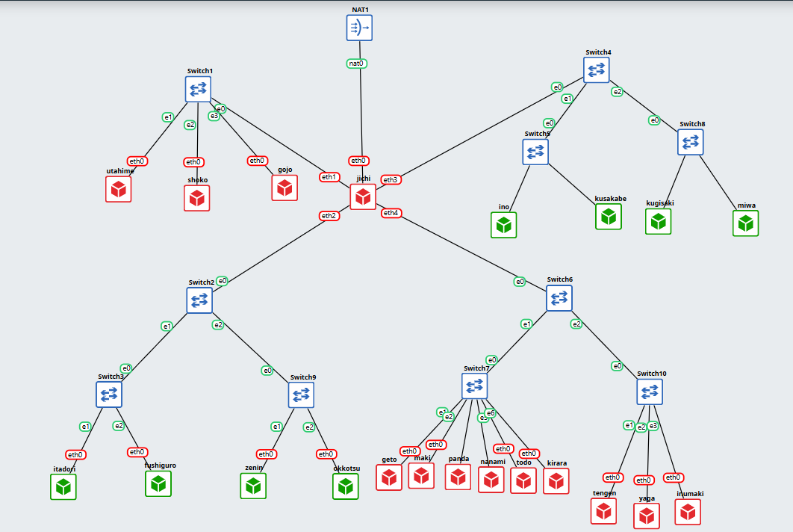

### Soal 1 (Elisabeth)
1. Konfigurasi Router Relay `jichi`:
   **Menambahkan DNS Resolver**:
   ```
   echo "nameserver 192.168.122.1" > /etc/resolv.conf
   ```
   **Mengaktifkan IP forwarding agar `jichi` berfungsi sebagai router**:
   ```
   echo 1 > /proc/sys/net/ipv4/ip_forward
   ```
   **Mengatur NAT Masquerade**:
   ```
   iptables -t nat -A POSTROUTING -o eth0 -j MASQUERADE
   ```
   **Pengalokasian Alamat IP Gateway**: 
   ```
   ip addr add 10.87.1.1/24 dev eth1   # Network 1
   ip addr add 10.87.2.1/24 dev eth2   # Network 2
   ip addr add 10.87.3.1/24 dev eth3   # Network 3
   ip addr add 10.87.4.1/24 dev eth4   # Network 4 
   ```
   **Aktivasi Interface**: 
   ```
   ip link set eth1 up
   ip link set eth2 up
   ip link set eth3 up
   ip link set eth4 up
   ```
2. Konfigurasi Interface Clients:
   **Klien Network 1 & Network 4 (IP Statis)**:
   ```
   auto eth0
   iface eth0 inet static
     address 10.87.1.2
     netmask 255.255.255.0
     gateway 10.87.1.1
   ```
   **Klien Network 2 & Network 3 (DHCP Client)**:
   ```
   auto eth0
   iface eth0 inet dhcp
   ```

 Hasil:  
 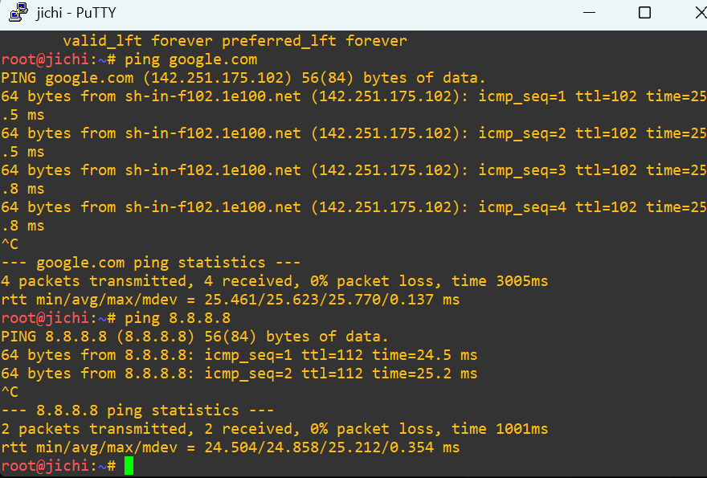  
 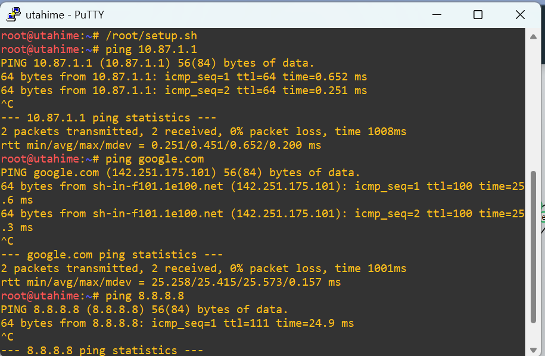  
 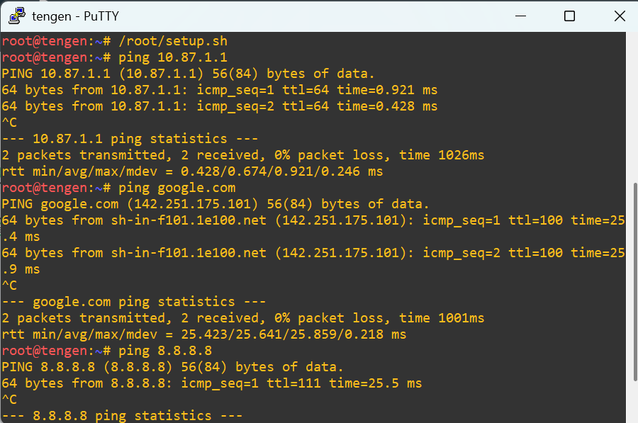
  
### Soal 2 (Elisabeth)
1. Konfigurasi DNS & Instalasi Paket:
   `tengen`:  
   **Menambahkan nameserver ke dalam `/etc/resolv.conf`**:
   ```
   echo "nameserver 192.168.122.1" > /etc/resolv.conf
   ```
   **Melakukan update repository dan menginstal paket DHCP server**:
   ```
   DEBIAN_FRONTEND=noninteractive apt-get update
   DEBIAN_FRONTEND=noninteractive apt-get install -y isc-dhcp-server
   ```
2. Deklarasi Subnet pada `/etc/dhcp/dhcpd.conf`:
   **Menambahkan deklarasi Subnet Network 4 agar layanan DHCP berjalan tanpa pool dinamis**:
   ```
   subnet 10.87.4.0 netmask 255.255.255.0 {
   }
   ```
   **Menambahkan Scope DHCP untuk Network 2**:
   ```
   subnet 10.87.2.0 netmask 255.255.255.0 {
       range 10.87.2.100 10.87.2.200;
       option routers 10.87.2.1;
       option domain-name-servers 192.168.122.1;
   }
   ```
   **Menambahkan Scope DHCP untuk Network 3**:
   ```
   subnet 10.87.3.0 netmask 255.255.255.0 {
       range 10.87.3.100 10.87.3.200;
       option routers 10.87.3.1;
       option domain-name-servers 192.168.122.1;
   }
   ```
4. Menentukan Interface dan Aktivasi Layanan:
   **Mengedit file `/etc/default/isc-dhcp-server` untuk mendaftarkan `eth0` ke dalam parameter `INTERFACESv4`. Melakukan *restart* layanan dan mengecek statusnya**:  
   ```
   service isc-dhcp-server restart
   service isc-dhcp-server status
   ```

Hasil:  
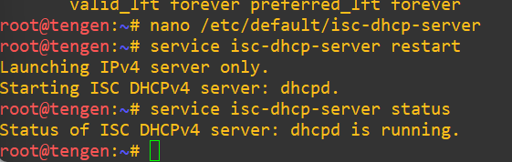
       
### Soal 3 (Elisabeth)
1. Instalasi DHCP Relay di Router `jichi`:
   **Melakukan update repositori dan menginstal paket relay**:
   ```
   apt-get update
   apt-get install -y isc-dhcp-relay
   ```
2. Konfigurasi Parameter Relay:
   **Mengedit file `/etc/default/isc-dhcp-relay` untuk mendefinisikan alamat server DHCP tujuan dan interface yang akan melayani relay**:
   ```
   SERVERS="10.87.4.10"
   INTERFACES="eth2 eth3 eth4"
   OPTIONS=""
   ```
3. Aktivasi Layanan Relay:
   **Melakukan *restart* pada layanan `isc-dhcp-relay` dan memverifikasi status *runnning* nya menggunakan `service isc-dhcp-relay status` serta `ps aux | grep dhcrelay`**.  
   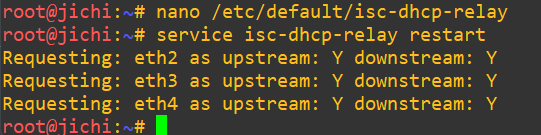
4. Pengujian Klien (`itadori` dan `ino`):
   **Meminta alokasi alamat IP secara dinamis melalui antarmuka `eth0` menggunakan perintah**:
   ```
   dhclient -v eth0
   ip a
   ```

Hasil:  
  
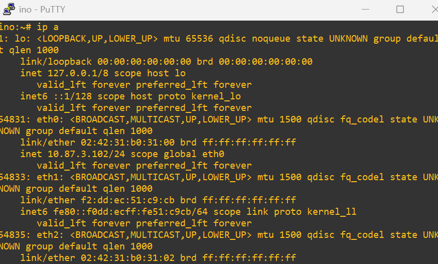

### Soal 4 (Elisabeth)
Catat MAC Address `itadori`, `fushiguro`, `maki`, `zenin` lalu,  
1. Deklarasi Kelas dan Subkelas Client:
   **Pada server `tengen`, edit `/etc/dhcp/dhcpd.conf`**:  
   Masukkan alamat MAC klien ke dalam kelompok `subclass` yang sesuai:
  ```
  nano /etc/dhcp/dhcpd.conf
  #ke ip 10.87.2.0
  # Deklarasi Kelas untuk Tim Dev (itadori & fushiguro)
  class "Dev" {
      match hardware;
  }
  subclass "Dev" 1:02:42:f7:f8:9b:00;
  subclass "Dev" 1:02:42:ed:4d:25:00;
  
  # Deklarasi Kelas untuk Tim Support (zenin & okkotsu)
  class "Support" {
      match hardware;
  }
  subclass "Support" 1:02:42:14:ef:e3:00;
  subclass "Support" 1:02:42:f5:2a:33:00;
  
  # Subnet Network 2 dengan pemisahan Pool
  subnet 10.87.2.0 netmask 255.255.255.0 {
      option routers 10.87.2.1;
      option domain-name-servers 192.168.122.1;
  
      # Pool 1 (Dev)
      pool {
          allow members of "Dev";
          range 10.87.2.10 10.87.2.35;
      }
  
      # Pool 2 (Support)
      pool {
          allow members of "Support";
          range 10.87.2.70 10.87.2.95;
      }
  }
  ```
2. Aktivasi Konfigurasi Server:
  ```
  service isc-dhcp-server restart
  service isc-dhcp-server status
  ```
3. Pembersihan Sesi dan Pengujian Client (`itadori`, `fushiguro`, `maki`, `zenin`):
   **Pada interface client, kosongkan sesi `ip addr flush dev eth0`**.
   **Bersihkan sisa data penyewaan IP melalui perintah `rm -f /var/lib/dhcp/dhclient*.leases` dan hapus file PID *dhclient* lama**.
   **Lakukan *restart node* lalu verifikasi perolehan IP baru menggunakan perintah `ip a`**.

Hasil:  
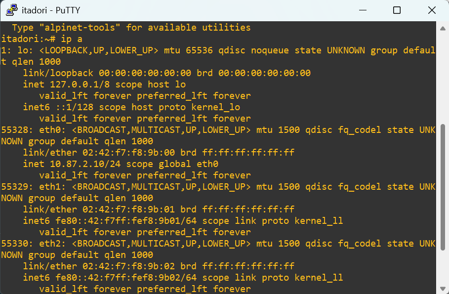  
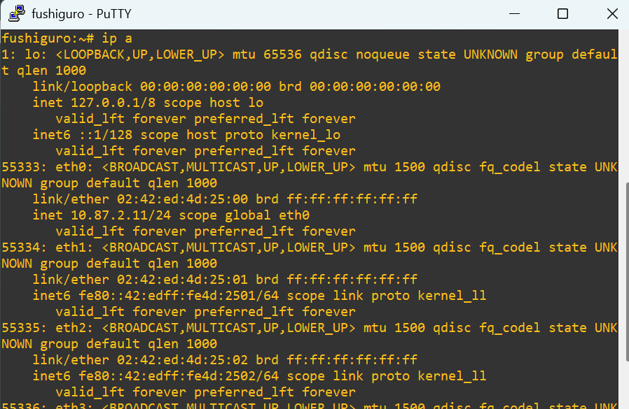  
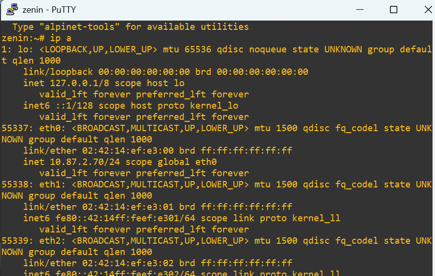  
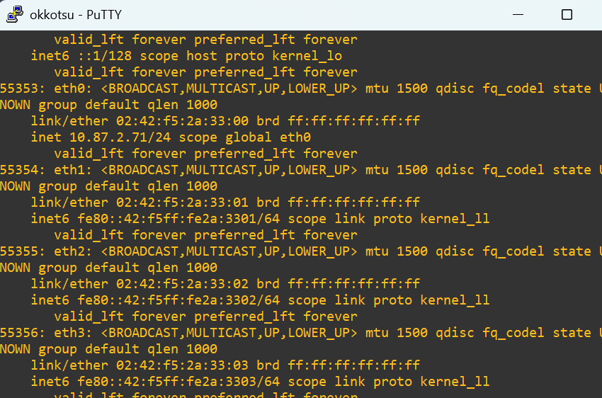

### Soal 5 (Elisabeth)
Catat MAC Address `ino`, `kusakabe`, `kugisaki`, `miwa` lalu,
1. Klasifikasi Client Berdasarkan MAC Address:
   **Buka file konfigurasi di server `tengen` menggunakan perintah nano /etc/dhcp/dhcpd.conf`**.
   ```
   # Kelas Short Lease untuk ino & kusakabe
    class "ShortLease" {
        match hardware;
    }
    subclass "ShortLease" 1:02:42:31:b0:31:00;
    subclass "ShortLease" 1:02:42:38:01:2b:00;
    
    # Kelas Long Lease untuk miwa
    class "LongLease" {
        match hardware;
    }
    subclass "LongLease" 1:02:42:0a:45:28:00;
    
    # Deklarasi Subnet Network 3 dengan Lease dan Options Khusus
    subnet 10.87.3.0 netmask 255.255.255.0 {
        option routers 10.87.3.1;
        option domain-name-servers 10.87.1.2, 10.87.1.3;
        option domain-search "K47.com";
    
        # Pool Short Lease (Durasi 30 menit / 1800 detik)
        pool {
            allow members of "ShortLease";
            range 10.87.3.10 10.87.3.89;
            default-lease-time 1800;
            max-lease-time 1800;
        }
    
        # Pool Long Lease (Durasi 12 jam / 43200 detik)[cite: 21]
        pool {
            allow members of "LongLease";
            range 10.87.3.100 10.87.3.199;
            default-lease-time 43200;
            max-lease-time 43200;
        }
    }
    ```
2. Aktivasi Konfigurasi dan Pengujian:
   **Terapkan layanan melalui `tengen` dengan perintah `service isc-dhcp-server restart` lalu pastikan beroperasi dengan baik lewat `service isc-dhcp-server status`**.
   **Lakukan *restart* pada semua *node*, tes `tengen` dengan `cat /var/lib/dhcp/dhcpd.leases`**.

Hasil:  
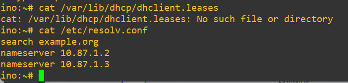  
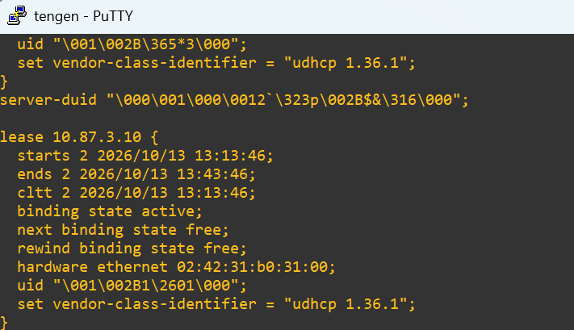  
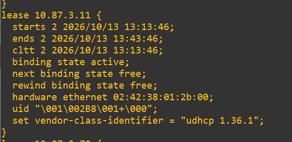  
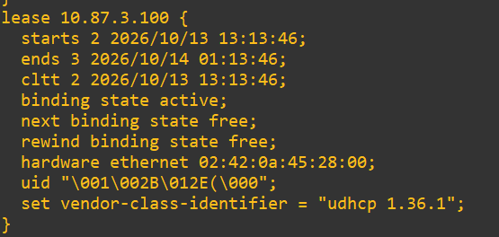

### Soal 6 (Elisabeth)
1. Konfigurasi Static Lease di Server `tengen`:
   **Buka file konfigurasi utama DHCP server menggunakan perintah `nano /etc/dhcp/dhcpd.conf`.
   **Tambahkan blok deklarasi `host` khusus untuk klien VIP (`kugisaki`) yang mengikat MAC Address perangkat (`02:42:d7:1d:92:00`) dengan alamat IP spesifik (`10.87.3.99`):
   ```
   # Konfigurasi Static Lease untuk Kugisaki (VIP)
       host kugisaki {
           hardware ethernet 02:42:d7:1d:92:00;
           fixed-address 10.87.3.99;
       }
   ```
    [cite: 34]

  2. Restart dan Verifikasi Layanan DHCP:
     **Terapkan konfigurasi baru dengan melakukan *restart* pada layanan `isc-dhcp-server` dan pastikan status layanannya kembali aktif (*running*):
     ```
     service isc-dhcp-server restart
     service isc-dhcp-server status
     ```

  3. Pengujian pada `kugisaki`:
     **Lakukan *restart* pada *node* client**.
     **Setelah *node* menyala kembali, jalankan perintah `ip a` untuk memverifikasi alamat antarmuka jaringan yang diperoleh dari server**.

Hasil:  
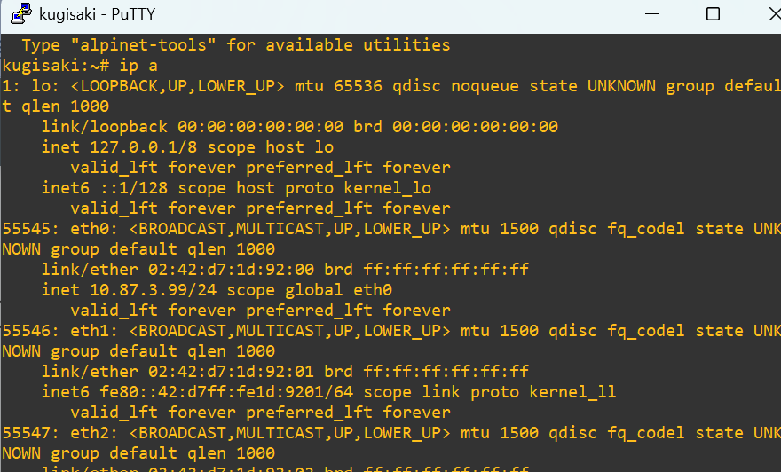

### Soal 7 (Elisabeth)
1. Pengecekan Daftar Sewa IP (DHCP Leases):
   `tengen`  
   **Jalankan perintah berikut untuk melihat secara langsung riwayat dan daftar alokasi IP dinamis yang sedang disewakan kepada client**:
   ```
   cat /var/lib/dhcp/dhcpd.leases
   ```

  2. Pengecekan Konfigurasi Utama DHCP:
     **Jalankan perintah berikut untuk membaca dan memverifikasi kembali seluruh aturan *subnet*, *class*, *pool*, dan reservasi statis**:
     ```
     cat /etc/dhcp/dhcpd.conf
     ```

Hasil:  
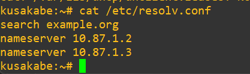  
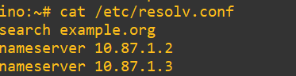  
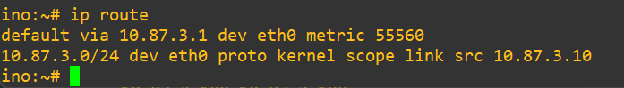  
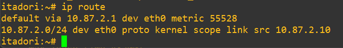

### Soal 8 (Elisabeth)
1. Monitoring Paket trafik di Server `tengen`:
   **Buka terminal pada server `tengen` dan gunakan `tcpdump` untuk memantau seluruh lalu lintas data yang masuk atau keluar melalui port DHCP (port 67 untuk server dan 68 untuk klien).
   ```
   tcpdump -i any -nn -v port 67 or port 68
   ```
   
2. Inisiasi Ulang Permintaan IP di `ino`:
   **Beralih ke terminal `ino`, kemudian matikan proses *client* DHCP yang mungkin masih berjalan di latar belakang menggunakan `pkill`**.
   ```
   pkill udhcpc
   udhcpc -i eth0 -n
   ```

Hasil:  
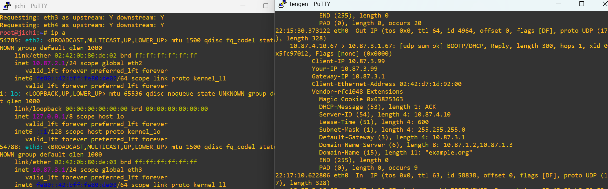

### Soal 9 (Elisabeth)
1. Simulasi Kegagalan Relay di `jichi`:
   **Buka terminal router `jichi` dan matikan layanan DHCP Relay untuk mensimulasikan terjadinya gangguan**:
   ```
   service isc-dhcp-relay stop
   ```

2. Pengujian Permintaan IP saat Gangguan (`ino`):
   **Beralih ke terminal klien `ino` dan paksa client untuk meminta alokasi IP baru menggunakan parameter `-n` (agar langsung keluar/berhenti jika gagal)**:
   ```
   udhcpc -i eth0 -n
   ```
3. Pemulihan Layanan Relay di `jichi`:
   **Kembali ke terminal `jichi` dan hidupkan ulang layanan DHCP Relay agar jalur distribusi kembali normal**:
   ```
   service isc-dhcp-relay start
   ```

4. Pengujian Permintaan IP (`ino`):
   ```
   udhcpc -i eth0 -n
   ```

Hasil:  
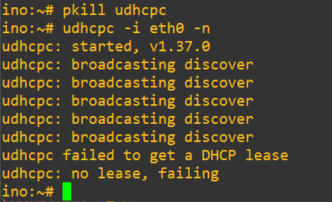  
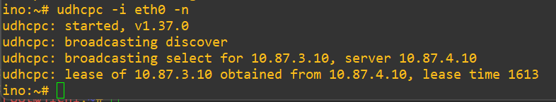  
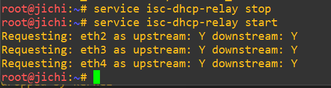

### Soal 10 (Elisabeth)
1. Aktivasi Autostart Layanan:
   **Buka terminal pada server `tengen` dan atur agar layanan DHCP Server otomatis menyala**:
   ```
   update-rc.d isc-dhcp-server defaults
   update-rc.d isc-dhcp-server enable
   ```
   **Buka terminal pada router `jichi` dan atur autostart untuk layanan DHCP Relay**:
   ```
   update-rc.d isc-dhcp-relay defaults
   update-rc.d isc-dhcp-relay enable
   ```
2. Restart Node dan Verifikasi Status Layanan:
   **Lakukan *restart* pada node `tengen` dan `jichi`**.
   **Setelah menyala kembali, pastikan status kedua layanan sudah *running* secara otomatis tanpa dihidupkan manual**:
   Di `tengen`: `service isc-dhcp-server status`
   Di `jichi`: `service isc-dhcp-relay status`
3. Pengujian Network 2 & 3:
   **Pada client perwakilan (misal `ino` untuk Network 3 dan `itadori` untuk Network 2), tarik IP baru**:
   ```
   udhcpc -i eth0
   ip a
   ip route
   ```
   **Lakukan tes konektivitas (Ping) antar-klien dan ke arah Data Center**:
   ```
   ping -c 3 10.87.4.10
   ```

Hasil:  
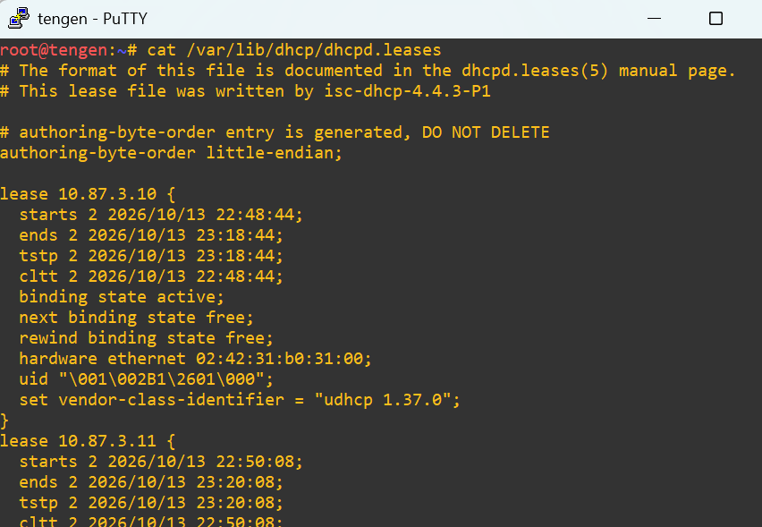  
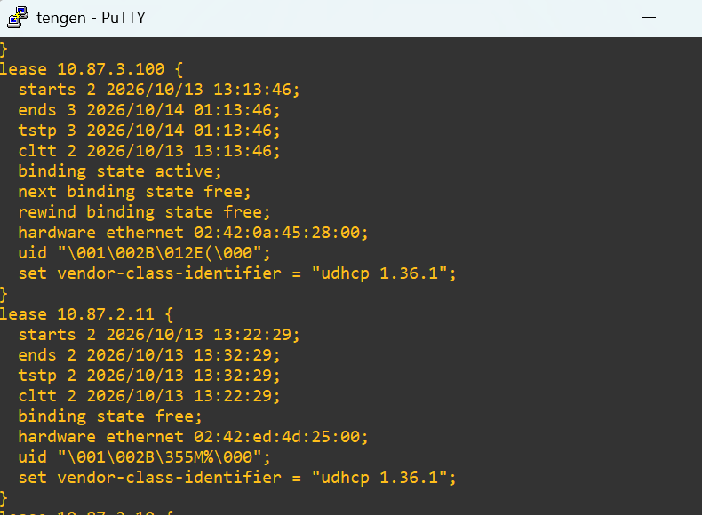  
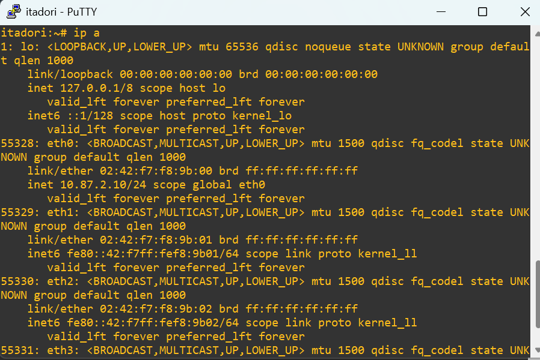  
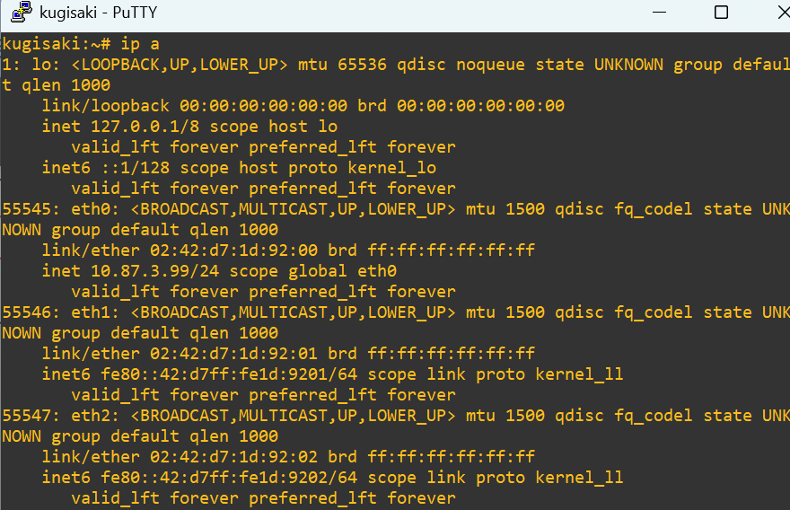  
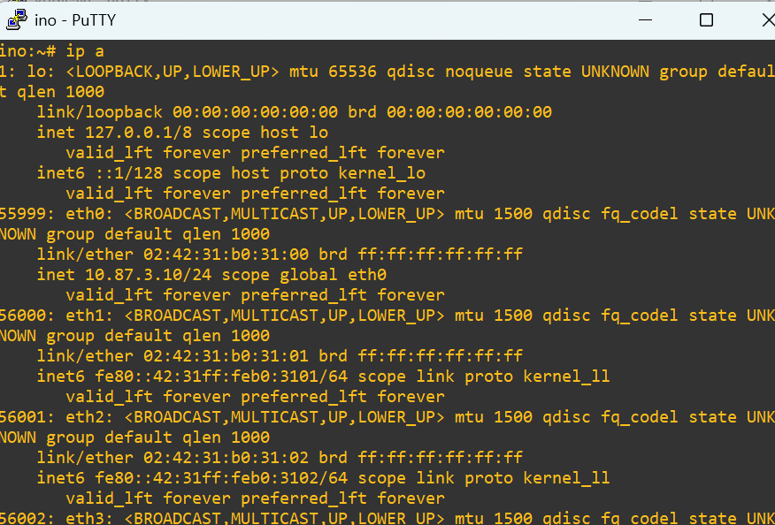  
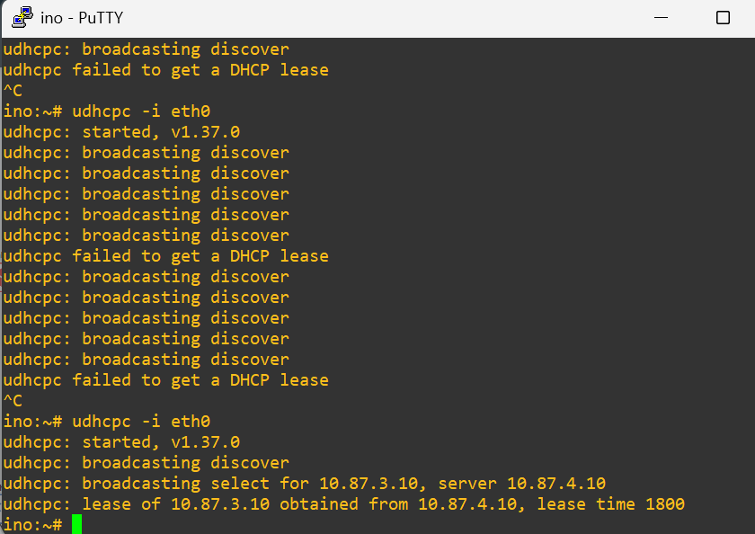  
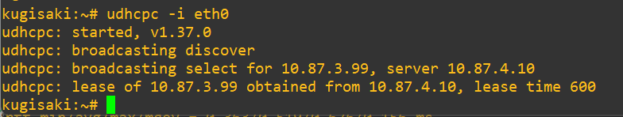  
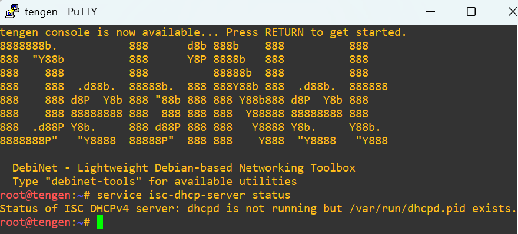  
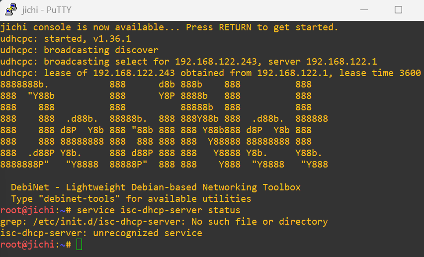  
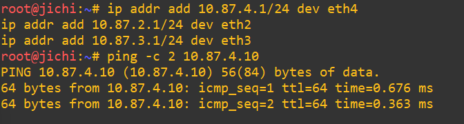  
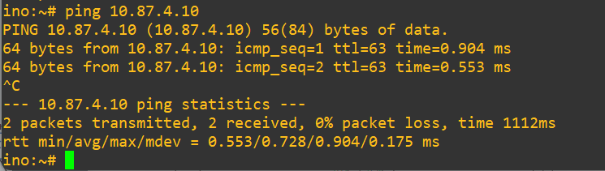  
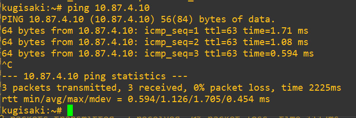  
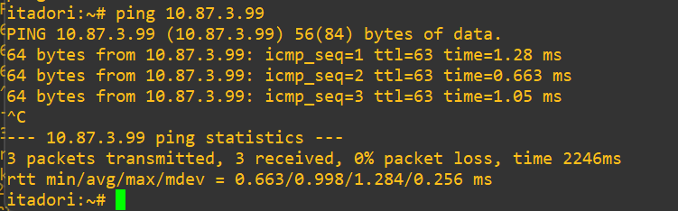  

### Soal 11 (Farrel)
1. Konfigurasi Router dan NAT: Buka terminal pada node jichi untuk mengaktifkan IP Forwarding, NAT Masquerade, dan konfigurasi IP Gateway untuk tiap Switch:
```
echo 1 > /proc/sys/net/ipv4/ip_forward
iptables -t nat -A POSTROUTING -o eth0 -j MASQUERADE

ip addr add 10.87.1.1/24 dev eth1
ip link set eth1 up
ip addr add 10.87.2.1/24 dev eth2
ip link set eth2 up
```
2. Konfigurasi Node Utahime (DNS Master): Atur rute default dan DNS resolver pada utahime agar bisa terhubung ke internet, lalu instal BIND9:
```
ip route add default via 10.87.1.1
echo "nameserver 8.8.8.8" > /etc/resolv.conf
echo "nameserver 8.8.4.4" >> /etc/resolv.conf

apt-get update
apt-get install bind9 bind9utils dnsutils -y
```
Edit Konfigurasi Master Zone: Buka file named.conf.local:
```
nano /etc/bind/named.conf.local
```
Isikan konfigurasi berikut:
```
zone "jujutsu.K47.com" {
    type master;
    file "/etc/bind/jujutsu/jujutsu.K47.com";
    allow-transfer { 10.87.1.3; };
    also-notify { 10.87.1.3; };
};
```
Buat File Record Zone Master:
```
mkdir -p /etc/bind/jujutsu
nano /etc/bind/jujutsu/jujutsu.K47.com
```
Isikan data record berikut, lalu restart layanan DNS:
```
$TTL    604800
@       IN      SOA     ns1.jujutsu.K47.com. admin.jujutsu.K47.com. (
                              2023102602 ; Serial
                                  604800 ; Refresh
                                   86400 ; Retry
                                 2419200 ; Expire
                                  604800 ) ; Negative Cache TTL
;
@       IN      NS      ns1.jujutsu.K47.com.
@       IN      NS      ns2.jujutsu.K47.com.

ns1     IN      A       10.87.1.2
ns2     IN      A       10.87.1.3
@       IN      A       10.87.1.2
test    IN      A       192.168.100.100
```
```
service named restart
```
3. Konfigurasi Node Shoko (DNS Slave): Buka terminal shoko, atur jaringan, instal BIND9, dan konfigurasi slave zone:
```
ip route add default via 10.87.1.1
echo "nameserver 8.8.8.8" > /etc/resolv.conf

apt-get update
apt-get install bind9 bind9utils dnsutils -y
```
Edit Konfigurasi Slave Zone:
```
nano /etc/bind/named.conf.local
```
Isikan konfigurasi slave, lalu restart layanan:
```
zone "jujutsu.K47.com" {
    type slave;
    file "/var/lib/bind/jujutsu.K47.com";
    masters { 10.87.1.2; };
};
```
4. Pengujian pada Client: Buka terminal pada itadori, atur IP jaringan, lakukan tes ping antar switch, dan pastikan query DNS berhasil dialihkan ke IP 192.168.100.100:
```
ip addr add 10.87.2.2/24 dev eth0
ip link set eth0 up
ip route add default via 10.87.2.1

ping -c 3 10.87.1.3
dig @10.87.1.3 test.jujutsu.K47.com
```
Hasil:


### Soal 12 (Farrel)
1. Menambahkan Konfigurasi Zone dan Record pada DNS Master: Buka terminal utahime, tambahkan CNAME dan update A record pada file zone jujutsu.K47.com:
```
nano /etc/bind/jujutsu/jujutsu.K47.com
```
Tambahkan baris berikut di bagian bawah:
```
@       IN      A       10.87.1.4
www     IN      CNAME   jujutsu.K47.com.
```
Daftarkan Reverse Zone ke named.conf.local:
```
nano /etc/bind/named.conf.local
```
```
zone "1.87.10.in-addr.arpa" {
    type master;
    file "/etc/bind/jujutsu/10.87.1.rev";
};
```
Buat File Reverse Zone (PTR):
```
nano /etc/bind/jujutsu/10.87.1.rev
```
Isikan:
```
$TTL    604800
@       IN      SOA     ns1.jujutsu.K47.com. admin.jujutsu.K47.com. (
                              2023102601 ; Serial
                                  604800 ; Refresh
                                   86400 ; Retry
                                 2419200 ; Expire
                                  604800 ) ; Negative Cache TTL
;
@       IN      NS      ns1.jujutsu.K47.com.
@       IN      NS      ns2.jujutsu.K47.com.

4       IN      PTR     jujutsu.K47.com.
```
Konfigurasi DNS Forwarder & Recursion:
```
nano /etc/bind/named.conf.options
```
Ubah file menjadi:
```
options {
    directory "/var/cache/bind";
    recursion yes;
    allow-query { any; };
    allow-recursion { any; };
    forwarders {
        192.168.122.1;
    };
    dnssec-validation no;
    listen-on-v6 { any; };
};
```
Lalu restart layanan:
```
service named restart
```
2. Pengujian pada Client: Buka terminal itadori, pastikan DNS resolver mengarah ke utahime (10.87.1.2), lalu lakukan pengujian CNAME, PTR, dan Ping Internet:
```
dig www.jujutsu.K47.com
dig -x 10.87.1.4
ping -c 3 google.com
```
Hasil:


### Soal 13 (Farrel)
1. Konfigurasi Routing untuk Network MariaDB: Di terminal jichi, tambahkan gateway untuk subnet databa
```
ip addr del 10.87.4.1/24 dev eth3 2>/dev/null
ip addr add 10.87.4.1/24 dev eth4
ip link set eth4 up
```
2. Konfigurasi Node Yaga (Master MariaDB): Atur rute, instal MariaDB, dan edit bind-address serta server-id:
```
ip route add default via 10.87.4.1
echo "nameserver 8.8.8.8" > /etc/resolv.conf

apt-get update
apt-get install mariadb-server -y

nano /etc/mysql/mariadb.conf.d/50-server.cnf
```
Sesuaikan baris berikut pada blok [mariadbd]:
```
bind-address            = 0.0.0.0
server-id               = 1
log_bin                 = /var/log/mysql/mysql-bin.log
skip-name-resolve
```
Pembuatan Database dan User Replikasi: Restart MariaDB lalu masuk ke terminal MySQL:
```
service mariadb restart
mysql -u root
```
```
CREATE DATABASE IF NOT EXISTS db_shibuya_K47;
USE db_shibuya_K47;

CREATE TABLE IF NOT EXISTS request_logs (
    id INT AUTO_INCREMENT PRIMARY KEY,
    log_message VARCHAR(255),
    created_at TIMESTAMP DEFAULT CURRENT_TIMESTAMP
);

CREATE USER IF NOT EXISTS 'replica'@'%' IDENTIFIED BY 'password_replica';
GRANT REPLICATION SLAVE ON *.* TO 'replica'@'%';

CREATE USER IF NOT EXISTS 'admin_shibuya'@'10.87.4.%' IDENTIFIED BY 'password_admin';
GRANT ALL PRIVILEGES ON db_shibuya_K47.* TO 'admin_shibuya'@'10.87.4.%';

FLUSH PRIVILEGES;
SHOW MASTER STATUS;
```
3. Konfigurasi Node Inumaki (Slave MariaDB): Atur IP, instal MariaDB, dan konfigurasi server-id:
```
ip route add default via 10.87.4.1
apt-get update
apt-get install mariadb-server -y

nano /etc/mysql/mariadb.conf.d/50-server.cnf
```
Sesuaikan blok [mariadbd]:
```
bind-address            = 0.0.0.0
server-id               = 2
skip-name-resolve
```
Restart MariaDB, lalu masuk ke MySQL dan buat struktur tabel awal:
```
service mariadb restart
mysql -u root
```
```
CREATE DATABASE IF NOT EXISTS db_shibuya_K47;
USE db_shibuya_K47;
CREATE TABLE IF NOT EXISTS request_logs (
    id INT AUTO_INCREMENT PRIMARY KEY,
    log_message VARCHAR(255),
    created_at TIMESTAMP DEFAULT CURRENT_TIMESTAMP
);
```
4. Penghubungan Replikasi dan Pengujian: Di terminal MariaDB inumaki, hubungkan ke Master menggunakan Log File dan Posisi yang dicatat sebelumnya:
```
STOP SLAVE;

CHANGE MASTER TO
    MASTER_HOST='10.87.4.9',
    MASTER_USER='replica',
    MASTER_PASSWORD='password_replica',
    MASTER_LOG_FILE='mysql-bin.000001',
    MASTER_LOG_POS=1699;

START SLAVE;
SHOW SLAVE STATUS \G
```
Hasil:
1. Jalankan di terminal yaga:
```
mysql -u root -e "USE db_shibuya_K47; INSERT INTO request_logs (log_message) VALUES ('Test Replikasi Database Yaga ke Inumaki Berhasil');"
```
2. Jalankan di terminal inumaki (harus muncul data yang sama):
```
mysql -u root -e "USE db_shibuya_K47; SELECT * FROM request_logs;"
```


### Soal 14 (Farrel)
1. Konfigurasi Geto (Reverse Proxy & Load Balancer): Instal Nginx dan atur konfigurasi upstream untuk load balancing frontend dan backend:
```
apt-get update
apt-get install nginx -y
nano /etc/nginx/nginx.conf
```
Tambahkan blok upstream dan server:
```
http {
    # ... [konfigurasi dasar] ...
    upstream frontend_pool {
        server 10.87.4.3;
        server 10.87.4.4;
    }
    upstream backend_pool {
        server 10.87.4.5;
        server 10.87.4.6;
        server 10.87.4.7;
    }
    server {
        listen 80 default_server;
        server_name jujutsu.K47.com _;

        location / {
            proxy_pass http://frontend_pool;
        }
        location /api {
            proxy_pass http://backend_pool/;
        }
    }
}
```
Lalu bersihkan file default dan restart:
```
rm -f /etc/nginx/sites-enabled/default
service nginx restart
```
2. Konfigurasi Maki & Panda (Frontend Worker): Instal Nginx dan buat halaman penanda index:
```
apt-get update && apt-get install nginx -y
echo "<h1>Frontend Server: maki</h1>" > /var/www/html/index.html
service nginx restart
```
3.Konfigurasi Nanami, Todo, Kirara (Backend Worker): Instal PHP, buat script API, dan atur Nginx:
```
apt-get update
apt-get install nginx php-fpm php-mysql -y
mkdir -p /var/www/api/api
nano /var/www/api/index.php
```
Isi dengan script koneksi database PHP (Insert Request Log). Lalu konfigurasi virtual host backend:
```
cp /var/www/api/index.php /var/www/api/api/index.php
nano /etc/nginx/sites-available/default
```
Pastikan root mengarah ke /var/www/api dan FastCGI PHP aktif. Restart layanan:
```
service nginx restart
service php8.4-fpm restart
```
4. Pengujian pada Client: Lakukan curl dari itadori:
```
curl -H "Host: jujutsu.K47.com" http://10.87.4.2
curl -H "Host: jujutsu.K47.com" http://10.87.4.2/api
```
Hasil:


### Soal 15 (Farrel)
1. Mengubah Pembobotan API di Geto: Buka file nginx.conf di geto dan atur rasio weight 3:1 untuk nanami dan todo:
```
nano /etc/nginx/nginx.conf
```
Sesuaikan bagian api_cluster:
```
upstream api_cluster {
    server 10.87.4.5 weight=3;
    server 10.87.4.6 weight=1;
}
```
Restart Nginx:
```
service nginx restart
```
2. Pengujian Rasio API: Jalankan loop request dari itadori untuk membuktikan rasio pembagian beban 3:1:
```
for i in {1..8}; do curl -s -H "Host: jujutsu.K47.com" http://10.87.4.2/api; echo ""; done
```
Hasil:


### Soal 16 (Farrel)
1. Konfigurasi Gateway Publik (Gojo): Instal Nginx dan atur routing berbasis path / ke frontend pool dan /api ke load balancer internal (geto):
```
apt-get update
apt-get install nginx -y
nano /etc/nginx/nginx.conf
```
Tambahkan blok upstream dan routing:
```
upstream frontend_pool {
    server 10.87.4.3;  # maki
    server 10.87.4.4;  # panda
}

server {
    listen 80;
    server_name jujutsu.K47.com www.jujutsu.K47.com;

    location / {
        proxy_pass http://frontend_pool;
        proxy_set_header Host $host;
    }

    location /api {
        proxy_pass http://10.87.4.2/api;
        proxy_set_header Host $host;
    }
}
```
```
rm -f /etc/nginx/sites-enabled/default
service nginx restart
```
2. Pengujian Routing dari Client: Akses IP gojo menggunakan domain host dari itadori:
```
curl -H "Host: jujutsu.K47.com" http://10.87.1.4
for i in {1..8}; do curl -s -H "Host: jujutsu.K47.com" http://10.87.1.4/api; echo ""; done
```
Hasil:


### Soal 17 (Farrel)
1. Modifikasi Tabel Database: Buka terminal MySQL di yaga dan tambahkan kolom client_ip:
```
USE db_shibuya_K47;
ALTER TABLE request_logs ADD COLUMN IF NOT EXISTS client_ip VARCHAR(45);
```
2. Forwarding Real IP di Proxy: Edit nginx.conf di Gojo dan Geto dengan menambahkan parameter proxy headers di setiap blok location:
```
proxy_set_header X-Real-IP $remote_addr;
proxy_set_header X-Forwarded-For $proxy_add_x_forwarded_for;
```
Setelah ditambahkan, restart Nginx pada kedua node tersebut.

3. Modifikasi Script API Backend: Perbarui index.php pada node nanami, todo, dan kirara agar membaca header IP dan menyimpannya:
```
$client_ip = $_SERVER['HTTP_X_REAL_IP'] ?? $_SERVER['HTTP_X_FORWARDED_FOR'] ?? $_SERVER['REMOTE_ADDR'];
// ... [script insert database untuk menyertakan variable $client_ip] ...
```
Restart layanan PHP (service php8.4-fpm restart).

4. Verifikasi: Lakukan curl dari client, lalu cek log database di yaga untuk memastikan IP client tercatat dengan benar.
Hasil:


### Soal 18 (Farrel)
1. Konfigurasi Backup Server (Kirara): Instal layanan web, salin script API yang sama seperti worker lain, lalu restart layanannya.
```
apt-get update
apt-get install nginx php-fpm php-mysql -y
```
2. Setup Failover di Geto: Buka file nginx.conf di geto dan modifikasi blok upstream API dengan menambahkan max_fails, fail_timeout, dan flag backup:
```
upstream api_cluster {
    server 10.87.4.5 weight=3 max_fails=2 fail_timeout=5s;
    server 10.87.4.6 weight=1 max_fails=2 fail_timeout=5s;
    server 10.87.4.7 backup;
}
```
Restart Nginx di geto.

3. Simulasi Failover: Matikan Nginx di nanami dan todo (service nginx stop), kemudian lakukan curl request dari itadori. Pastikan traffic otomatis dilempar ke server cadangan (kirara).
```
for i in {1..8}; do curl -s -H "Host: jujutsu.K47.com" http://10.87.1.4/api; echo ""; done
```
Simulasi gangguan dengan mematikan worker utama (nanami & todo):
```
service nginx stop
```
```
curl -H "Host: jujutsu.K47.com" http://10.87.1.4/api
```
Hasil:


### Soal 19 (Farrel)
1. Konfigurasi Direktori & Nginx: Di terminal gojo, buat folder cache dan seting limit di nginx.conf:
```
mkdir -p /var/cache/nginx/jujutsu_cache
chown -R www-data:www-data /var/cache/nginx/jujutsu_cache
nano /etc/nginx/nginx.conf
```
Tambahkan baris berikut di blok http:
```
proxy_cache_path /var/cache/nginx/jujutsu_cache levels=1:2 keys_zone=jujutsu_cache:10m max_size=100m inactive=60m use_temp_path=off;
limit_req_zone $binary_remote_addr zone=api_limit:10m rate=10r/s;
```
Lalu terapkan pada location / untuk Cache dan location /api untuk Rate Limiting:
```
location / {
    # ...
    proxy_cache jujutsu_cache;
    proxy_cache_valid 200 302 10m;
    add_header X-Cache-Status $upstream_cache_status;
}
location /api {
    limit_req zone=api_limit burst=5 nodelay;
    # ...
}
```
Restart Nginx: service nginx restart.

2. Pengujian: Di itadori, cek status header cache (X-Cache-Status: HIT/MISS) dengan curl -I, dan uji spam rate limit ke endpoint API.
```
curl -I -H "Host: jujutsu.K47.com" http://10.87.1.4/

for i in {1..20}; do curl -s -I -H "Host: jujutsu.K47.com" http://10.87.1.4/api | grep "HTTP/"; done
```
Hasil:


### Soal 20 (Farrel)
1. Uji Load Testing Klien: Dari terminal itadori, jalankan looping request untuk mengukur responsibilitas halaman utama dan efek pemblokiran rate limit (kode 503):
```
time for i in {1..100}; do curl -s -I -H "Host: jujutsu.K47.com" http://10.87.1.4/ > /dev/null; done
```
```
for i in {1..30}; do echo -n "Request $i: "; curl -s -I -H "Host: jujutsu.K47.com" http://10.87.1.4/api | head -n 1; done
```
2. Pemeriksaan Access Log: Di terminal gojo, buka access log Nginx untuk memverifikasi request mana saja yang sukses (200 OK) dan mana yang diblokir oleh Nginx rate limit (503 Service Unavailable):
```
tail -n 30 /var/log/nginx/access.log
```
Hasil:


